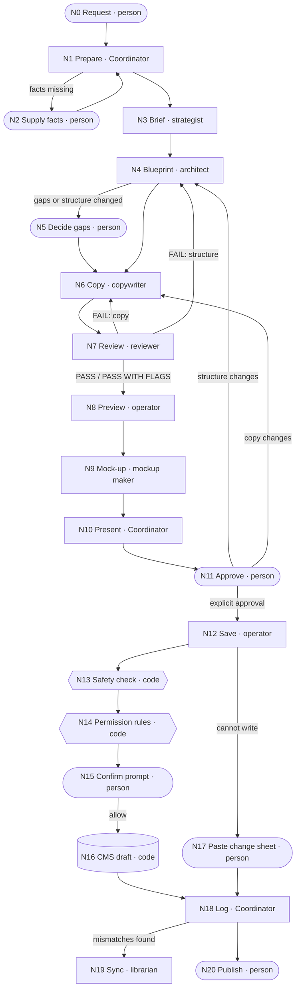

# Workflow graph

How the content-team plugin moves a request from the user to an unpublished CMS draft. This describes
`create-page` and `update-page` (the main graph) and the supporting workflows that prepare a project's
knowledge files. The source of truth is the plugin itself: `plugins/content-team/skills/*/SKILL.md`,
`plugins/content-team/agents/*.md` and `plugins/content-team/hooks/`. If this page and the plugin disagree,
the plugin wins and this page needs updating.

Every node is one of three kinds:

| Kind | Meaning |
| --- | --- |
| **Agent** | Claude. Either the **Coordinator** (the main Claude session following a skill) or a plugin sub-agent (`content-team:<agent>`). |
| **Code** | Deterministic software: the safety-check hook, Claude Code's permission rules, the CMS API. |
| **Person** | A human decision or action. The graph waits until it happens. |

## Nodes

### Main graph: create-page and update-page

| Id | Node | Kind | Reads | Produces |
| --- | --- | --- | --- | --- |
| N0 | Request | Person | — | The request in the conversation ("create a page for…", "update the … page") |
| N1 | Prepare | Agent (Coordinator) | `project.md`; `cms/component-catalogue.md`, `cms/cms-mapping.md`; `learned/*`; freshness-check rules; for updates, the target story (read-only CMS lookup) | Run folder `runs/<YYYY-MM-DD>-<slug>/` with copies of the run templates; freshness result (up to date, or a mismatch list); questions for the user |
| N2 | Supply missing facts | Person | The Coordinator's single question | Answers (topic, key facts, dates, prices; which project or story if several match) |
| N3 | Brief | Agent (content-strategist) | Request; `project.md`; `learned/content-model.md`, `learned/voice-notes.md`; `extras/` files `project.md` points to; CMS (read-only) for existing stories on the topic | `brief.md`; decision new vs update with a reason; open questions; any permission problem |
| N4 | Blueprint | Agent (page-architect) | `brief.md`; `project.md`; `cms/component-catalogue.md`; `learned/content-model.md`; `learned/page-patterns/*.md`; for updates, the current story content | `blueprint.json` (structure, copy fields empty); outline; `component_gaps`; `assumptions` |
| N5 | Decide component gaps | Person | The outline and each gap with its closest existing component | One decision per gap: use closest component, drop the section, or pause for developers (recorded in `blueprint.json` `component_gaps[].decision`) |
| N6 | Copy | Agent (copywriter) | `brief.md`; `blueprint.json`; `project.md` (Voice, Must-follow, SEO); `learned/voice-notes.md`; `extras/`; writing, SEO and accessibility defaults | `blueprint.json` with every text field filled in every language; `[TODO: …]` markers; `human_checks` |
| N7 | Review | Agent (content-reviewer) | `blueprint.json`; `project.md`; `cms/component-catalogue.md`; defaults; review template | `review.md` (PASS / FAIL / FLAG per check); `blueprint.json` `review.result` = `PASS`, `PASS WITH FLAGS` or `FAIL` |
| N8 | Preview | Agent (cms-operator, preview mode) | `blueprint.json`; `review.md`; `cms/cms-mapping.md`; `cms/component-catalogue.md`; for updates, the current story (read-only CMS) | `preview.md`: full story listing (create) or field-by-field diff old → new (update); unmapped items |
| N9 | Mock-up | Agent (page-mockup-maker) | `blueprint.json`; `review.md`; `preview.md`; `learned/mockup-kit/*`; `learned/site-notes.md`; mock-up format | `mockup.html` (after view, plus a collapsed before view for updates); list of approximations |
| N10 | Present for approval | Agent (Coordinator) | `blueprint.json`; `review.md`; `preview.md`; `mockup.html` | Summary in the conversation: title, folder/slug, languages, outline (or diff), reviewer result, every FLAG and `human_check`, assumptions, `[TODO]`s, mock-up path |
| N11 | Approve | Person | The summary and the run folder files | Explicit approval wording, or change requests |
| N12 | Save | Agent (cms-operator, save mode) | The approval wording; `blueprint.json`; `preview.md`; `review.result` | A CMS create/update call for a draft story with the project's tag (default `ai-draft`); after saving, `blueprint.json` `saved.story_id` and `saved.preview`; an entry in `log.md`. If it cannot write: `change-sheet.md` |
| N13 | Safety check | Code (`hooks/guard-cms-writes.py`) | The tool name and parameters of every `execute_mutating`, `execute_destructive`, `upload_asset` or `upload_asset_finish` call on any server | Block (exit 2, with a reason) or "ask" (the user must confirm the draft save) |
| N14 | Permission rules | Code (workspace `.claude/settings.json`) | The tool name | `mcp__*__execute_mutating` asks; `mcp__*__execute_destructive` and `mcp__*__upload_asset*` are denied |
| N15 | Confirm save prompt | Person | The `[plugin:content-team]` prompt naming the story | Allow or deny the single CMS call |
| N16 | CMS | Code (Storyblok Management API) | The allowed create/update call | An unpublished draft story; the story id |
| N17 | Paste change sheet | Person | `change-sheet.md` | The draft entered by hand in the CMS; confirmation to the Coordinator |
| N18 | Log | Agent (Coordinator) | Everything above | Completed `log.md` (request, story id, gaps, reviewer result, approver, link, knowledge-check result) |
| N19 | Sync knowledge files | Agent (component-librarian, sync mode) | `project.md`; the mismatch list | Edited draft files in `cms/` and `learned/`, or `<name>.new.md` beside reviewed ones |
| N20 | Publish | Person | The draft in the CMS | The live page. The only way anything goes live |

### Supporting workflows

| Id | Node | Kind | Reads | Produces |
| --- | --- | --- | --- | --- |
| S1 | Write project.md | Person | `_template/project.md`, `_example/project.md` | `<Project>/project.md`, optional `extras/` documents |
| S2 | Check project.md and CMS access | Agent (Coordinator, setup-project) | `project.md`; CMS (one read-only call) | List of blocking and weakening gaps; access level |
| S3 | Draft knowledge files | Agent (component-librarian, setup mode) | `project.md`; all CMS components and stories (read-only); format files | `cms/component-catalogue.md`, `cms/cms-mapping.md`, `learned/content-model.md`, `learned/page-patterns/*.md`, `learned/voice-notes.md`, all marked `Status: draft`; `runs/<date>-setup/log.md` (written by the Coordinator) |
| S4 | Review knowledge files | Person (ideally with a developer for `cms/`) | The drafted files | Corrections; `Status: draft` changed to `Status: reviewed` |
| S5 | Refresh catalogue | Agent (component-librarian, refresh mode) | CMS components (read-only); current `cms/component-catalogue.md` | New catalogue with a "Changes" section, or `component-catalogue.new.md` beside a reviewed one; affected mapping entries and page patterns |
| S6 | Build mock-up kit | Agent (Coordinator, with a browser) | `project.md` (site URL); `learned/site-notes.md`; `learned/page-patterns/*.md`; `cms/component-catalogue.md`; the live or local site | `learned/mockup-kit/site.css`, `header.html`, `footer.html`, `components/<component>.html`, `kit.md`, `kit-preview.html` |

## Shared state

Steps never call each other directly. They exchange information through these files and through the
conversation. Who writes each one is fixed.

| File | Written by | Read by | Notes |
| --- | --- | --- | --- |
| `<Project>/project.md` | Person only | Every node | Top authority. No agent ever edits it |
| `<Project>/extras/*` | Person only | N3, N6, N7 | Read-only for agents |
| `cms/component-catalogue.md` | S3, S5 | N1, N4, N7, N8, S6 | Never overwritten once reviewed; a `.new.md` is written beside it |
| `cms/cms-mapping.md` | S3, N19 | N1, N8 | Maps neutral sections to CMS components and field keys |
| `learned/content-model.md`, `learned/page-patterns/*.md`, `learned/voice-notes.md` | S3, N19 | N1, N3, N4, N6 | `Status: draft` files are suggestions; `Status: reviewed` files are rules |
| `learned/mockup-kit/*` | S6 | N9 | Optional. Without it, N9 uses generic styling |
| `runs/<YYYY-MM-DD>-<slug>/brief.md` | N3 | N4, N6, N9 | What to make and why |
| `runs/…/blueprint.json` | N4 (structure), N5 (gap decisions), N6 (text), N7 (`review.result` only), N12 (`saved.*` only) | N6–N12 | The single shared artefact of the run. Each writer changes only its own fields |
| `runs/…/review.md` | N7 | N8, N9, N10, N12 | Reviewer findings with a fix for each |
| `runs/…/preview.md` | N8 | N9, N10, N12 | N12 checks it still matches the blueprint before saving |
| `runs/…/mockup.html` | N9 | N10, N11 | For the person only; never sent to the CMS |
| `runs/…/change-sheet.md` | N12 (only when it cannot write) | N17 | Field-by-field values to paste by hand |
| `runs/…/log.md` | N12 (appends), N18 | People (audit trail) | Commit `runs/` folders to keep who approved what |
| The conversation | N0, N2, N5, N11 (person); N10 (Coordinator) | Coordinator | Approval exists only here. Silence or general enthusiasm is not approval |

## Edges

The Coordinator launches each agent with the paths it needs and waits for its output before moving on.
Arrows are the normal order; the routing rules below say when an edge is skipped or repeated.

| From | To | What moves |
| --- | --- | --- |
| N0 | N1 | The request |
| N1 | N2 | One question with everything only the user can give |
| N2 | N1 | Answers |
| N1 | N3 | Request, project path, run path, rules paths, mismatch list (and, for updates, the existing story id) |
| N3 | N4 | `brief.md` |
| N4 | N5 | Outline and component gaps |
| N5 | N6 | Gap decisions recorded in `blueprint.json` |
| N4 | N6 | `blueprint.json` (when there are no gaps and no outline to show) |
| N6 | N7 | `blueprint.json` with copy |
| N7 | N6 or N4 | FAIL items with fixes (once) |
| N7 | N8 | `review.md`, `review.result` |
| N8 | N9 | `preview.md` |
| N9 | N10 | `mockup.html` and approximations |
| N10 | N11 | The approval summary |
| N11 | N4, N6 or N7 | Change requests, routed to the agent that owns them |
| N11 | N12 | The approval wording |
| N12 | N13 → N14 → N15 → N16 | One CMS write call, checked by code, then confirmed by the person |
| N12 | N17 | `change-sheet.md` |
| N16, N17 | N18 | Story id and editor link, or "saved manually by human" |
| N18 | N19 | The mismatch list (only if the person accepts the offer) |
| N18 | N20 | The editor link. The person publishes in the CMS, outside the plugin |
| S1 → S2 → S3 → S4 | N1 | A project with `cms/` and `learned/` files. Required before any page run |
| S5, S6 | N1 | A refreshed catalogue or a mock-up kit |

## Routing rules

Each rule is an explicit if/then. "Stop" means the Coordinator explains the problem to the user and waits;
nothing further runs until the user acts.

### Preparing a run (N1)

- **If** the working folder has no `project.md` and no subfolder with one, **then** stop and tell the user to
  copy `_template/` and fill in `project.md`.
- **If** several projects exist and the user didn't name one, **then** ask which (N2).
- **If** `cms/component-catalogue.md` or `cms/cms-mapping.md` is missing, **then** stop and tell the user to run
  "set up the <Project> project" (S2 → S3).
- **If** those files are still `Status: draft`, **then** say so once and continue.
- **If** the CMS tools appear under any server name other than `Storyblok`, **then** never call them, even to
  read: stop and tell the user to connect Storyblok through `.mcp.json` and switch the other connection off.
- **If** the freshness check finds mismatches, **then** show the list, continue with `project.md` winning, pass
  the list to every agent and record each item in the blueprint `assumptions`. **If** a mismatch changes what
  the run may do (a permission or a never-touch item), **then** state that before N3 starts.
- **If** the run folder name for today's date and this slug is already taken, **then** never overwrite it: use
  `<YYYY-MM-DD>-<slug>-2`, then `-3`, and so on.
- **If** the request lacks something only the user can give (topic, key facts, dates, prices), **then** ask once,
  in one question (N2).
- **If** (update-page) the story lookup matches several stories, **then** ask which. **If** the story sits under
  "Never touch" in `project.md`, **then** stop and explain.

### Brief and blueprint (N3–N5)

- **If** the strategist finds an existing page on the same topic, **then** it recommends updating it, and the
  Coordinator offers to switch to update-page.
- **If** the target location is under "Never touch", or the writable locations are unknown, **then** the
  strategist writes no brief and reports the problem; the Coordinator stops and shows it.
- **If** a fact is unknown, **then** every agent writes `[TODO: …]` instead of inventing it.
- **If** the blueprint has component gaps, **then** the person decides each one at N5 (use closest, drop, or
  pause for developers). **If** they choose to pause, **then** the run stops until developers add the
  component and the catalogue is refreshed (S5).
- **If** (update-page) the structure doesn't change, **then** skip showing the outline; gaps are still handled at N5.
- **If** (update-page) the request is translation-only, **then** skip N4: the copywriter adds the language to
  the existing fields.

### Review fails validation (N7)

- **If** `review.result` is `FAIL`, **then** send the FAIL items back once: copy problems to the copywriter
  (N6), structure problems to the page-architect (N4). Then review again.
- **If** the second review still fails, **then** stop and show the user the FAIL items. Nothing goes to
  preview or the CMS.
- **If** `review.result` is `PASS WITH FLAGS`, **then** continue, and show every FLAG at N10.
- **If** `project.md` "Must-follow" claims are unknown, **then** the reviewer FLAGs every claim, price,
  percentage, outcome and health or treatment statement. It never PASSes them.

### Preview and mock-up (N8–N9)

- **If** something in the blueprint can't be mapped to a CMS component or field, **then** the operator lists it
  in `preview.md` and the Coordinator shows it at N10.
- **If** the project has no `learned/mockup-kit/`, **then** the mock-up uses generic styling, and the
  Coordinator mentions once that "build the mock-up kit" (S6) makes it look like the site.
- **If** (update-page) the change is text-only, in three fields or fewer, with no structural change, **then**
  skip N9 unless the user asks for a mock-up.

### Approval and saving (N11–N17)

- **If** the person gives anything other than explicit approval (silence, "looks great"), **then** don't save;
  ask for explicit approval.
- **If** the person asks for changes, **then** route them to the owning agent (structure → N4, copy → N6) and
  run review, preview and mock-up again before asking for approval again.
- **If** the operator in save mode finds `review.result` is `FAIL`, or `preview.md` is missing or doesn't match
  the current blueprint, **then** it doesn't save.
- **If** the call is anything other than `createStory` or `updateStory`, or carries a publish, schedule,
  force-update, AI-translate or per-language publish option, **then** the safety check (N13) blocks it.
- **If** the call is `execute_destructive` or an asset upload, **then** both N13 and N14 block it.
- **If** the safety check can't read the call, or python3 is missing, **then** it blocks the call (fails closed).
- **If** the safety check allows a draft save, **then** the person still confirms it at N15.
- **If** the connector can't write (no create/update operation, the call is refused, or the safety check
  blocks it), **then** the operator doesn't retry or look for another route: it writes `change-sheet.md`, and the
  Coordinator tells the user to paste it in (N17) and records "saved manually by human" in `log.md` once
  they confirm.

### After saving (N18–N20)

- **If** the freshness check found mismatches, **then** offer to sync the knowledge files (N19). Run it only
  on a yes. Files marked `Status: reviewed` get a `.new.md` beside them instead of an edit.
- **If** `project.md` looks wrong (it lists a page or folder that doesn't exist in the CMS), **then** raise it as
  a question for the person. Never edit `project.md`.
- **Always** the run ends with an unpublished draft. Publishing (N20) is a person's action in the CMS.

### Setup and refresh (S2–S6)

- **If** `project.md` has a blocking gap (no CMS space, no writable locations), **then** stop setup and offer the
  exact wording to add.
- **If** `project.md` has weakening gaps (voice, SEO, claims or approvals unknown), **then** continue with the
  defaults and list them.
- **If** the CMS region is needed and unknown, **then** ask the user; never guess.
- **If** a knowledge file is `Status: reviewed`, **then** the librarian writes `<name>.new.md` beside it instead
  of overwriting it.
- **If** a refresh changes anything `cms/cms-mapping.md` depends on, **then** recommend the user reviews the
  mapping with a developer before the next page is saved.
- **If** no browser tool is available, **then** S6 stops; mock-ups stay generic until a kit exists.
